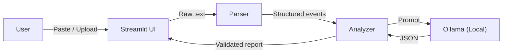

## What I Built

**LogSloth** is a local-first cybersecurity tool that takes SSH authentication logs and produces a concise, evidence-grounded security briefing using an open-weight language model — entirely on your machine.

The problem is real: anyone who manages a Linux server with SSH access has scrolled through hundreds of repetitive `auth.log` lines looking for the handful that actually matter. Failed password spam from bots. Brute-force attempts against `root`. That one successful login from an IP you don't recognise. It's tedious, error-prone, and exactly the kind of work that *should* be automated — but shipping your authentication logs to a cloud AI service raises obvious privacy concerns.

LogSloth solves this with a strictly local pipeline:

1. **Deterministic parsing** — Regex-based extraction identifies failed passwords, accepted logins, invalid users, brute-force patterns, and session events. Every event gets a stable ID (E001, E002, …) and a source-line reference. The parser handles counting and fact extraction — the LLM never invents events.

2. **Local AI analysis** — The parsed events are sent to **Qwen2.5** (1.5B default, with 7B fully supported) running locally via **Ollama**. The model produces a structured JSON report: an executive summary, a review priority (Low/Medium/High), findings with evidence citations, safe recommendations, and explicit limitations.

3. **Evidence validation** — Before displaying results, LogSloth checks every event ID the model cites. If the model references `E999` but only 50 events exist, that citation is stripped and flagged. No fabricated evidence reaches the user.

4. **Export** — Download the full report as Markdown or JSON for documentation, sharing, or integration with other tools.

### Connection to "Slow and Steady"

LogSloth channels the spirit of the sloth 🦥: instead of frantically scrolling through hundreds of log lines, let a local AI do the slow, careful reading and deliver a concise briefing. Your logs deserve a thoughtful read, not a panicked scroll. And because the model runs locally, it's as steady as it gets — no API rate limits, no surprise outages, no vendor changes.

## Demo & How It Works

<!-- TODO: Replace with actual demo video link after recording -->
> **Demo video:** [PLACEHOLDER — Record using the instructions in docs/DEMO_SCRIPT.md and add link here]

### How it works:

**Step 1: Load your logs** — Paste raw auth.log lines, upload a `.log` file, or load the included synthetic sample (uses RFC 5737 documentation-only IPs).

**Step 2: Review parse results** — See metrics at a glance: total lines, events parsed, unrecognized lines. Drill into event-type breakdowns, top source IPs, and username frequency.

**Step 3: Run AI analysis** — Click "Analyze with Local AI." The parsed events are sent to Qwen2.5 running locally via Ollama. The model returns a structured security briefing.

**Step 4: Review findings** — Each finding includes a title, description, severity, and evidence IDs that link back to specific parsed events. The executive summary and priority rating give you an instant overview.

**Step 5: Export** — Download the complete report as Markdown (for docs/wikis) or JSON (for automation).

### Architecture

The key architectural decision is **parsing before prompting**: the LLM receives pre-counted, pre-categorised facts with stable IDs. It analyses patterns and writes natural-language findings — but it cannot invent events, miscount logins, or fabricate IP addresses.

### Tech Stack

- **Python 3.12** + **Streamlit** for the web UI
- **Ollama** for local model inference
- **Qwen2.5 1.5B/7B** (Apache 2.0) as the open-weight model family
- **pytest** for automated testing (50+ tests covering parser, analyzer, schemas, privacy invariants)

### What Was Tested

- Parser correctly identifies 9 event types across the synthetic dataset
- Malformed, empty, and mixed-valid input handled gracefully
- Evidence validation strips fabricated event IDs from model output
- Malformed JSON from the model raises clear errors (no silent failures)
- Model-unavailable scenarios show setup instructions instead of fake results
- All IPs in the sample dataset verified as RFC 5737 documentation ranges
- Default Ollama client only communicates with localhost
- Parser does not execute content from log lines (even adversarial ones)
- Markdown and JSON export produce valid, complete reports

## Why Open Innovation Matters Here

This is a project where open-source AI isn't a nice-to-have — it's a *requirement*.

**Privacy is non-negotiable.** Authentication logs contain IP addresses, usernames, timestamps, and server hostnames that reveal your infrastructure topology. Sending them to `api.openai.com` or any cloud endpoint creates a data-exposure surface that contradicts the entire purpose of security monitoring. LogSloth runs the model locally via Ollama — your logs never leave your machine.

**No API keys, no accounts, no costs.** Once Ollama and the model are installed, LogSloth runs forever for free. No rate limits. No billing surprises. No terms-of-service changes that could break your workflow.

**Model freedom.** Don't like Qwen2.5? Swap in Llama, Gemma, Mistral, or any Ollama-compatible model. Fine-tune on your own log formats. No permission needed, no vendor approval process.

**Offline operation.** LogSloth works on air-gapped networks — common in environments where SSH log analysis is most critical. Download the model once, then disconnect.

**Transparency.** The model weights are published and inspectable. You can audit what's running on your machine. The application code is MIT-licensed. The model is Apache 2.0.

## GitHub / Project Repository Link

- [LogSloth on GitHub (Open Source, MIT License)](https://github.com/shauryamalhotra957-wq/logsloth)

---

*Built for Hacktoberfest 2026 Week 3: Slow and Steady 🦥*

*LogSloth project code is MIT licensed. Qwen2.5 models are Apache 2.0 licensed by Alibaba Cloud.*
