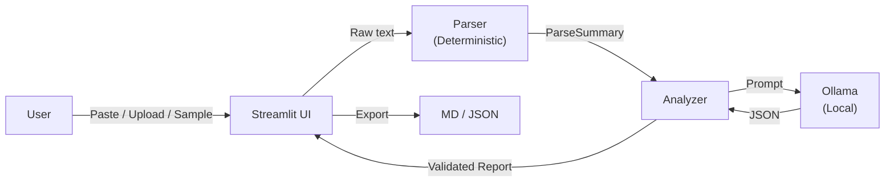

# 🦥 LogSloth

**Stop reading authentication logs line by line. Get a useful security briefing locally.**

[](LICENSE)
[](https://python.org)
[](https://hacktoberfest.com)

---

## The Problem

System administrators and developers who manage Linux servers regularly need
to review SSH authentication logs (`/var/log/auth.log`). These logs can
contain hundreds or thousands of lines of repeated failed logins, brute-force
attempts, and routine session events — mixed in with the few lines that
actually matter.

Reading them line by line is tedious, error-prone, and slow. Missing an
important pattern (like credential stuffing from a new IP) can have real
consequences. But shipping your authentication logs to a cloud AI service
raises obvious privacy and compliance concerns.

## Who Is This For?

- **System administrators** who manage SSH-accessible servers.
- **DevOps engineers** who need quick security triage without reading raw logs.
- **Security teams** who want a first-pass briefing before deeper investigation.
- **Homelab enthusiasts** who want to understand what's hitting their servers.

## What LogSloth Does

LogSloth takes your SSH authentication logs — pasted, uploaded, or from a
bundled sample — and produces a concise, evidence-grounded security briefing
in seconds, entirely on your local machine.

1. **Deterministic parsing** extracts structured events (failed passwords,
   accepted logins, invalid users, brute-force patterns) with stable IDs
   and source-line references.

2. **Local AI analysis** via Ollama sends the parsed events to an open-weight
   model (Qwen2.5 7B by default) to generate a structured report: executive
   summary, priority rating, findings with evidence citations, recommendations,
   and acknowledged limitations.

3. **Evidence validation** ensures the model can only reference events that
   actually exist in the parsed data. Fabricated event IDs are stripped and
   flagged.

4. **Export** the full report as Markdown or JSON for sharing, archival, or
   integration with other tools.

## Features

- 🔒 **Local-first** — Logs never leave your machine. No API keys, no accounts, no telemetry.
- 🧠 **Open-weight AI** — Uses Qwen2.5 7B (Apache 2.0) via Ollama. Swap any compatible model.
- 🔍 **Deterministic parsing** — Regex-based extraction with stable event IDs. The LLM never invents facts.
- ✅ **Evidence validation** — Every model citation is checked against real parsed events.
- 📊 **Structured dashboard** — Parse metrics, event breakdowns, IP/user frequency, findings with severity.
- 📤 **Export** — Download reports as Markdown or JSON.
- 🧪 **Synthetic sample** — Included test dataset with RFC 5737 documentation-only IPs.
- 🛡️ **Safety-first** — Never executes commands, blocks IPs, or modifies your system.
- ⚠️ **Honest limitations** — Clearly distinguishes observed facts from possible explanations.

## Architecture



| Module | Responsibility | Uses LLM? |
|--------|---------------|-----------|
| `app.py` | Streamlit UI & session management | No |
| `logsloth/parser.py` | Deterministic regex-based log parsing | No |
| `logsloth/analyzer.py` | Prompt construction & response validation | Yes (via client) |
| `logsloth/ollama_client.py` | HTTP client for local Ollama API | Yes |
| `logsloth/schemas.py` | Data models (dataclasses) | No |

See [docs/ARCHITECTURE.md](docs/ARCHITECTURE.md) for detailed design decisions.

## Why Open-Weight AI?

LogSloth uses an open-weight model for critical reasons:

1. **Privacy** — Authentication logs contain IP addresses, usernames, and
   timestamps that reveal your infrastructure. They should not be sent to a
   third-party cloud API.

2. **Local control** — You run the model on your own hardware. No vendor
   lock-in, no rate limits, no surprise costs, no terms-of-service changes.

3. **Transparency** — The model weights are published and inspectable.
   You can verify what's running on your machine.

4. **Freedom to adapt** — Swap `qwen2.5:7b` for any Ollama-compatible model.
   Fine-tune on your own log formats. No permission needed.

5. **Offline capability** — Works on air-gapped networks once the model is
   downloaded. No internet required for analysis.

## Installation

### Prerequisites

- **Python 3.10+** ([python.org](https://python.org))
- **Ollama** ([ollama.com/download](https://ollama.com/download))

### Windows

```powershell
# Clone the repository
git clone https://github.com/shauryamalhotra957-wq/logsloth.git
cd logsloth

# Create and activate virtual environment
python -m venv .venv
.\.venv\Scripts\Activate.ps1

# Install dependencies
pip install -r requirements.txt
```

### macOS / Linux

```bash
# Clone the repository
git clone https://github.com/shauryamalhotra957-wq/logsloth.git
cd logsloth

# Create and activate virtual environment
python3 -m venv .venv
source .venv/bin/activate

# Install dependencies
pip install -r requirements.txt
```

### Set Up Ollama

```bash
# Start Ollama (if not already running)
ollama serve

# Pull the default model (in a separate terminal)
ollama pull qwen2.5:7b
```

### Run LogSloth

```bash
streamlit run app.py
```

Open `http://localhost:8501` in your browser.

## Usage

1. **Load logs** — Paste auth.log lines, upload a `.log`/`.txt` file, or load the synthetic sample.
2. **Review parse results** — Check event counts, types, source IPs, and usernames.
3. **Run AI analysis** — Click "Analyze with Local AI" to generate a security briefing.
4. **Review findings** — Read the executive summary, priority rating, and evidence-linked findings.
5. **Export** — Download the report as Markdown or JSON.

## Testing

```bash
# Activate virtual environment first
# Windows: .\.venv\Scripts\Activate.ps1
# Linux/macOS: source .venv/bin/activate

# Run all tests
pytest tests/ -v
```

### Test Coverage

- ✅ Parser: successful and failed authentication, invalid users, edge cases
- ✅ Parser: malformed input, empty input, blank lines
- ✅ Parser: event ID uniqueness and sequential numbering
- ✅ Schemas: JSON/Markdown export round-trips
- ✅ Ollama client: connectivity checks, generation, error handling (mocked)
- ✅ Analyzer: evidence validation, fabricated ID rejection
- ✅ Analyzer: malformed model output handling
- ✅ Analyzer: model unavailable errors
- ✅ Export: Markdown and JSON report generation
- ✅ Privacy: RFC 5737 IP validation, localhost-only client, no telemetry
- ✅ Safety: parser does not execute log content

### Integration Testing

When Ollama is running with `qwen2.5:7b` available, the full end-to-end
workflow can be tested by loading the synthetic sample in the Streamlit UI
and running the AI analysis.

## Privacy & Limitations

### Privacy

- All processing runs locally via Ollama. No log data is sent to external services.
- No accounts, API keys, or telemetry are required.
- Uploaded logs are held in Streamlit session state only — not persisted to disk.
- You are responsible for securing your device and any exported reports.

### Limitations

- LogSloth provides **informational analysis only**, not definitive security assessments.
- The AI model may misinterpret patterns or miss important events.
- Repeated failed logins are **not automatically proof** of a successful breach.
- LogSloth **never** executes commands, blocks IPs, or modifies your system.
- The parser supports common sshd/pam syslog formats. Custom or non-standard
  log formats may not be fully recognised.
- Always verify findings with your own expertise and additional tools.

## License

This project is licensed under the **MIT License** — see [LICENSE](LICENSE).

### Model License

LogSloth uses **Qwen2.5 7B** by default, released under the **Apache License 2.0**
by Alibaba Cloud.

- Model: [Qwen/Qwen2.5-7B](https://huggingface.co/Qwen/Qwen2.5-7B)
- License: [Apache 2.0](https://www.apache.org/licenses/LICENSE-2.0)

The model license is separate from this project's MIT license.

## Demo

See [docs/DEMO_SCRIPT.md](docs/DEMO_SCRIPT.md) for a 60–90 second walkthrough.

<!-- TODO: Add actual demo video link when recorded -->

## Built For

🎃 **Hacktoberfest 2026 — Week 3: Slow and Steady**

*"Slow and steady wins the race — especially when reading auth logs."*

LogSloth channels the spirit of the sloth: instead of frantically scrolling
through hundreds of log lines, let a local AI do the slow, careful reading
for you and deliver a concise briefing. Because your logs deserve a thoughtful
read, not a panicked scroll.

---

*Built with Python, Streamlit, Ollama, and Qwen2.5 7B.*
