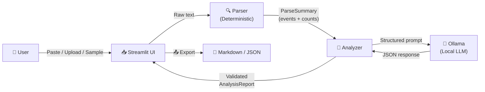

# LogSloth Architecture

## Overview

LogSloth is a local-first SSH authentication log analyzer. It combines
deterministic log parsing with open-weight AI analysis to produce
evidence-grounded security briefings — all without sending data off your machine.

## Data Flow

## Module Responsibilities

| Module | Role | Uses LLM? |
|--------|------|-----------|
| `app.py` | Streamlit UI, user interaction, session state | No |
| `logsloth/parser.py` | Deterministic regex-based log parsing | No |
| `logsloth/analyzer.py` | Prompt construction, response validation | Yes (via client) |
| `logsloth/ollama_client.py` | HTTP client for local Ollama API | Yes |
| `logsloth/schemas.py` | Data models (dataclasses) for events & reports | No |

## Key Design Decisions

### 1. Deterministic Parsing First

The parser uses compiled regular expressions to extract structured events
from syslog-formatted lines. All counts, event types, usernames, IPs, and
line references are established **before** the AI model sees anything.

The LLM receives pre-parsed facts — it never counts events or invents IPs.

### 2. Evidence Validation

Every event gets a stable ID (E001, E002, …). When the model's response
references evidence IDs, the analyzer validates that each ID actually exists
in the parser output. Fabricated IDs are stripped and flagged as warnings.

### 3. Local-Only Inference

The Ollama client communicates only with `localhost:11434` by default.
No API keys, no cloud endpoints, no telemetry. Logs stay on the user's machine.

### 4. Structured Output

The model is prompted to return raw JSON matching a strict schema. The
analyzer extracts JSON from the response (handling markdown fences and
preamble text), validates the structure, and builds typed dataclasses.

### 5. Graceful Degradation

If Ollama is unavailable, the UI still shows parsed events and metrics.
The AI analysis section shows setup instructions instead of fake results.

## Security Boundaries

- **Logs are untrusted input.** They are parsed but never executed.
- **Model output is untrusted.** It is validated before display.
- **No system-changing actions.** LogSloth never blocks IPs, modifies
  firewalls, or runs shell commands.
- **No persistence by default.** Uploaded logs are held in Streamlit
  session state only and discarded when the session ends.
